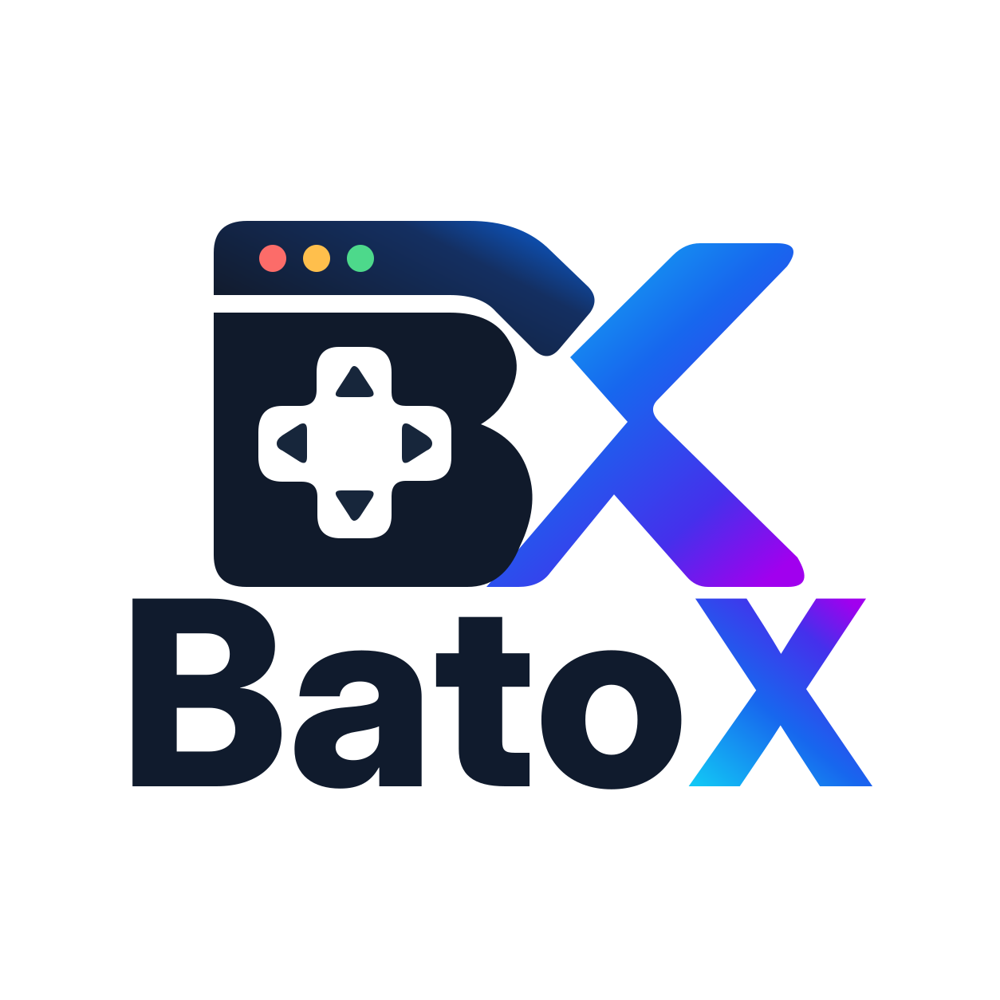

<p align="center">
  <picture>
    <source media="(prefers-color-scheme: dark)" srcset="docs/assets/batox-logo-dark.svg">
    
  </picture>
</p>

<h1 align="center">BatoX Apps</h1>

<p align="center">
  <strong>On-screen overlay apps for Batocera: messages and widgets drawn on top of your games, in pure Go with no system dependencies.</strong>
</p>

<p align="center">
  <a href="https://github.com/monteirohat/batox-apps/actions/workflows/ci.yml"></a>
  <a href="https://github.com/monteirohat/batox-apps/releases"></a>
  <a href="LICENSE"></a>
</p>

---

Batocera runs **sway**, a Wayland compositor, and BatoX Apps use its **overlay layer** to show
things above everything on the screen, fullscreen games included. The overlays never take the
controller: the game keeps playing while a message is on screen.

Each app is a single static binary: no CGO, no libraries to install on the console, fonts
embedded. They run on Raspberry Pi (arm64) and x86_64 PCs with Batocera 43 or newer.

Part of the [BatoX](https://github.com/monteirohat/BatoX) project.

## Apps

| App | What it does |
|---|---|
| `batox-message` | Shows a message card on top of the game for a few seconds. |
| `batox-timer` | Shows a countdown in a corner of the screen; at zero, closes the game or powers the console off. |

### batox-message

```bash
batox-message "Dinner is ready!"
batox-message -position center -seconds 10 -title "Mom" "Time for bed."
batox-message -title "" "Line one\nLine two"
```

| Option | Default | |
|---|---|---|
| `-position` | `top` | `top`, `center` or `bottom` |
| `-seconds` | `6` | how long the message stays on screen |
| `-title` | `BatoX` | small line above the message (`""` for none) |
| `-scale` | `1` | text size multiplier |
| `-verbose` | | prints the compositor socket used, to diagnose a message that doesn't appear |

Long messages wrap automatically, up to four lines.

### batox-timer

```bash
batox-timer -duration 30m                                   # close the game in 30 minutes
batox-timer -duration 1h -corner bottom-left -action shutdown
batox-timer -duration 2m -dry-run                           # try it: nothing is closed
```

| Option | Default | |
|---|---|---|
| `-duration` | `30m` | countdown length: `45m`, `1h`, `1h30m`... (up to 24 h) |
| `-corner` | `top-right` | `top-left`, `top-right`, `bottom-left` or `bottom-right` |
| `-action` | `close-game` | at zero: `close-game`, `shutdown` or `none` |
| `-title` | `Time left` | small line above the time (`""` for none) |
| `-done-title` | `Time's up` | the title once the time is over |
| `-scale` | `1` | size multiplier |
| `-dry-run` | | at zero, only print what would happen |

The timer turns amber in the last minute and red in the last 10 seconds. At zero it shows
"Time's up" for a few seconds, then:

- **close-game** closes the running game through EmulationStation (unsaved progress is lost); if
  no game is running, nothing happens;
- **shutdown** powers the console off;
- **none** only shows the timer.

Stopping the timer early (Ctrl+C, or `pkill batox-timer`) removes it from the screen and does
nothing else. To keep it running after closing the SSH session, start it with
`nohup batox-timer -duration 30m >/dev/null 2>&1 &`.

## Installing on the console

Download the binaries for your console from the
[latest release](https://github.com/monteirohat/batox-apps/releases/latest)
(`-linux-arm64` for Raspberry Pi, `-linux-amd64` for PCs), then:

```bash
ssh root@batocera.local "mkdir -p /userdata/system/batox-apps"
scp batox-message-linux-arm64 root@batocera.local:/userdata/system/batox-apps/batox-message
ssh root@batocera.local "chmod +x /userdata/system/batox-apps/batox-message"
```

Run the apps over SSH or from scripts. They find sway's socket on their own, through
EmulationStation's environment; no environment variables are needed.

## Building

Requires Go 1.24+ and `make`.

```bash
make build                         # every app, for arm64 and amd64, into build/
make deploy HOST=batocera.local    # builds for the Pi and copies every app to the console
make fmt && make vet && make test
```

## Project layout

```
cmd/        the apps, one folder each
ui/         what to draw: theme, fonts, text, shapes, components such as Card
overlay/    how to show it: the connection to sway and the on-screen surface
docs/       architecture and how to create an app
```

- [Architecture](docs/architecture.md): how the overlay works, from the Wayland protocol to pixels.
- [Creating an app](docs/creating-an-app.md): a step-by-step guide, with a countdown example.

The `overlay` and `ui` packages can also be imported by other Go programs, such as BatoX itself.

## License

[MIT](LICENSE). BatoX Apps is an independent project, not affiliated with or endorsed by the
Batocera project.
